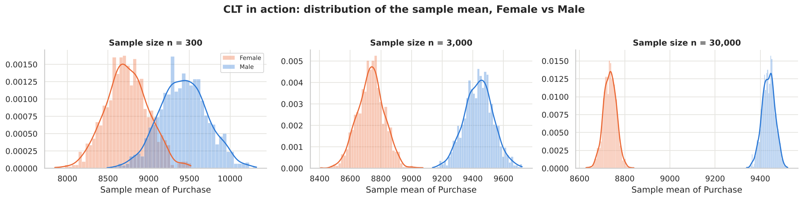
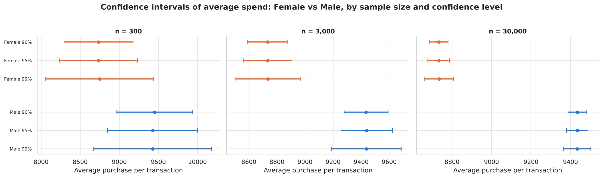
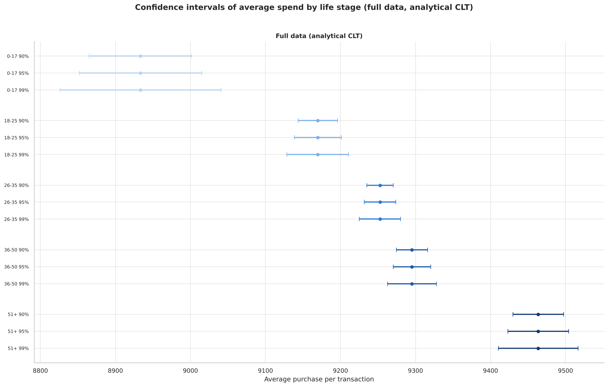

# Walmart Black Friday: Do Women Spend More Than Men?

**Confidence Intervals and the Central Limit Theorem applied to 550,068 retail transactions**

   

A business case study from the Scaler Data Science program. Walmart's management wants to know whether spending habits differ between male and female customers on Black Friday, and how marital status and age affect spend. The analysis uses bootstrapped sampling distributions (CLT) and 90 / 95 / 99% confidence intervals to generalise from a sample of transactions to a population of 50 million male and 50 million female customers.

📓 **[Notebook](notebooks/Walmart_CLT_Case_Study.ipynb)** · 📄 **[PDF report](reports/Walmart_CLT_Case_Study.pdf)** · 📝 **[Insights & recommendations](reports/insights_and_recommendations.md)** · 📊 **[CI results (CSV)](results/)**

---

## Key results

| Question | Answer (per transaction, 95% CI, full data) |
|---|---|
| Do women spend more than men? | **No.** Men: **9,437.5** [9,422, 9,453]. Women: **8,734.6** [8,709, 8,760]. Men spend ~703 (8%) more. |
| Do the gender CIs overlap? | **No**, at 90%, 95% and 99%. They overlap only with tiny samples (n = 300). |
| Why the gap? | **Product mix.** Men buy more high-ticket Category 1; women more of Categories 5 and 8. Within the same category women pay the same as men, and re-weighting women's prices by men's basket mix closes 100% of the gap. |
| Married vs Unmarried? | **No difference.** 9,261 vs 9,266; CIs overlap at every sample size and confidence level (t-test p = 0.73). |
| Age? | **Spend rises with age:** 0-17 (8,934) < 18-25 (9,170) < 26-35 (9,253) ≈ 36-50 (9,295) < 51+ (9,464). 26-35 vs 36-50 is borderline: separate at 90%, overlapping at 95% and 99%. |
| Per customer (total Black Friday spend)? | Men ~925K vs women ~712K (no overlap). The **26-35** shopper is the most valuable customer (~990K). |

<p align="center">
  <br>
  <em>The CLT in action: sample means become normal and tighter as n grows; male and female means separate from n = 3,000.</em>
</p>
<p align="center">
  <br>
  <em>Female vs Male confidence intervals at 90/95/99% for three sample sizes.</em>
</p>
<p align="center">
  <br>
  <em>Confidence intervals by life stage (full data).</em>
</p>

## Recommendations (summary)

1. **Win more women shoppers**: women are half the population but only ~28% of Black Friday customers.
2. **Help women discover bigger-ticket products** with bundles that pair Categories 5 and 8 with higher-value items.
3. **Keep male shoppers loyal**: they bring 77% of Black Friday revenue.
4. **Don't price by marital status**: use it only to decide *which* products to show.
5. **Focus the main campaign on ages 26-50**; treat 26-35 and 36-50 as one segment.
6. **Premium offers for 51+**, who have the highest spend per item.
7. **Reach teenagers through parents** with family bundles.
8. **Stock premium ranges in City C** (highest ticket size) and upsell in City A.
9. **Never run out of Categories 1, 5 and 8** (~74% of transactions).
10. **Test on large samples** and use 95% confidence for big decisions.

Full write-up: [reports/insights_and_recommendations.md](reports/insights_and_recommendations.md)

## What's inside the analysis

1. Problem statement, data structure, dtype conversion to `category`, statistical summary
2. Non-graphical analysis: value counts and unique values
3. Missing values (none) and outliers (IQR rule: 0.49%, all genuine premium purchases)
4. Univariate plots (histogram/KDE, count plots), bivariate box plots, crosstab heatmaps, correlation heatmap, pairplot
5. Gender: means, Welch t-test, effect size, product-mix decomposition of the gap
6. CLT experiments: 1,000 bootstrap means at n = 300 / 3,000 / 30,000, Q-Q normality checks, CI width vs sample size
7. 90 / 95 / 99% confidence intervals (bootstrap percentile and analytical z) with automated overlap checks
8. Same analysis for Married vs Unmarried and for five life-stage age bins (plus ANOVA)
9. Bonus: customer-level confidence intervals of total Black Friday spend
10. Final insights and plain-language recommendations

## Repository structure

```
├── data/
│   └── walmart_data.csv                 # raw dataset, 550,068 rows x 10 columns
├── notebooks/
│   └── Walmart_CLT_Case_Study.ipynb     # executed notebook with all outputs
├── reports/
│   ├── Walmart_CLT_Case_Study.pdf       # PDF export (22 pages)
│   ├── Walmart_CLT_Case_Study.html      # HTML export
│   └── insights_and_recommendations.md  # submission-ready text
├── images/                              # all 18 charts as PNG
├── results/                             # confidence-interval tables as CSV
├── scripts/
│   ├── build_notebook.py                # generates the notebook from source
│   └── export_pdf.js                    # HTML -> PDF via headless Chromium
└── requirements.txt
```

## Dataset

| Column | Description |
|---|---|
| User_ID | Customer ID |
| Product_ID | Product ID |
| Gender | Sex of customer |
| Age | Age in bins (0-17, 18-25, 26-35, 36-45, 46-50, 51-55, 55+) |
| Occupation | Occupation (masked) |
| City_Category | Category of the city (A, B, C) |
| Stay_In_Current_City_Years | Years in current city |
| Marital_Status | 0 = Unmarried, 1 = Married |
| Product_Category | Product category (masked) |
| Purchase | Purchase amount |

## How to reproduce

```bash
pip install -r requirements.txt
cd notebooks
jupyter nbconvert --to notebook --execute --inplace Walmart_CLT_Case_Study.ipynb
```

The notebook writes its charts to `images/` and CI tables to `results/`. All sampling uses a fixed random seed (42), so results are reproducible. Runtime is about one minute.

## Author

**Guntuku Hariprasad** · GitHub [@dot-hpg](https://github.com/dot-hpg)
